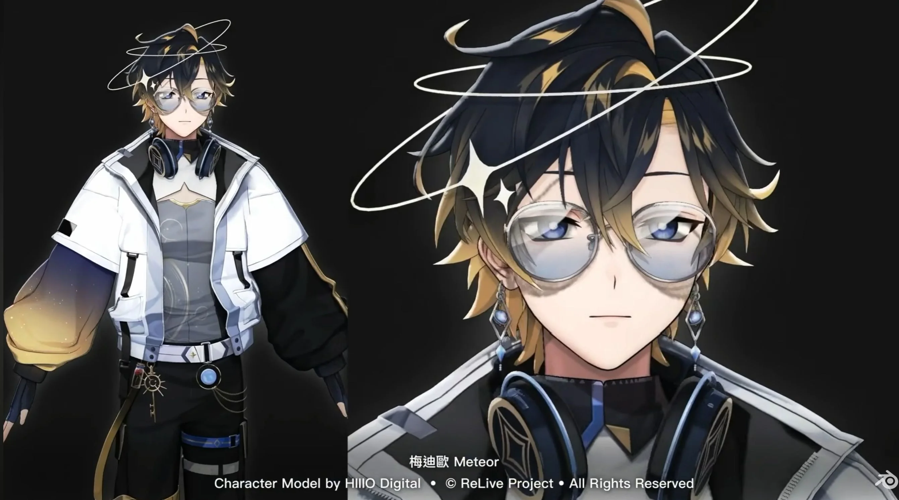
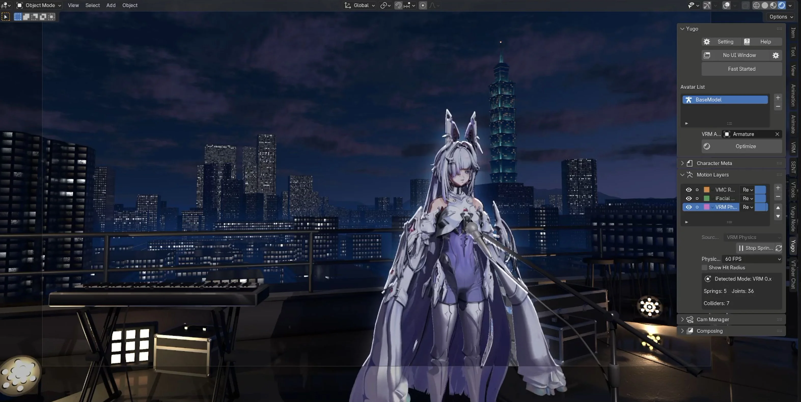

  <strong>English</strong> ·
  <a href="docs/readme/README.zh-TW.md">繁體中文</a> ·
  <a href="docs/readme/README.ja.md">日本語</a> ·
  <a href="docs/readme/README.ko.md">한국어</a> ·
  <a href="docs/readme/README.es.md">Español</a> ·
  <a href="docs/readme/README.pt-BR.md">Português (Brasil)</a> ·
  <a href="docs/readme/README.fr.md">Français</a>

<h1 align="center">Yugo - Blender Vtubing</h1>

  <strong>Turn Blender into a data mixing hub for VTubing and interactive experiences.</strong>

  
  
  

  <a href="https://hiiiodigital.com/Yugo-Docs/tutorials/getting-started.html">Quick start</a> ·
  <a href="https://hiiiodigital.com/Yugo-Docs/">Showcase</a> ·
  <a href="https://hiiiodigital.com/Yugo-Docs/">FAQ</a> ·
  <a href="https://hiiiodigital.com/Yugo-Docs/">Documentation</a>

Yugo DOC is the hub for tutorials, node references, and other project resources.

Yugo - Blender Vtubing is a Blender add-on for combining live tracking and interactive inputs, such as keyboard events and stream chatroom messages, in one visual workflow. Mix data from different sources to bring a character to life, then use the same building blocks to explore new ways for characters and objects to interact. Keyboard and stream chatroom support is currently in development.

## What you can do

- **Bring in live performance.** Receive body motion and expressions through VMC, and facial tracking through iFacialMocap. More tracking methods are in development.
- **Shape motion and expressions.** Blend sources, choose which parts of the body or face they affect, and adjust strength, smoothing, mirroring, and motion delay.
- **Add physical interaction.** Use Blender's rigid body settings to define how scene objects behave, and combine them with VRM spring physics for character and object interactions.
- **Build your own combinations.** Combine multiple motion sources with values, math, timing, and conditions to create your own performance and interaction setups.

## A hub for creative interaction

The idea is simple: bring data into Blender, mix and transform it, then decide how it affects your scene.

Yugo is designed to grow beyond avatar control into a toolkit for live performances, playful interactions, and experiments built inside Blender.

*A scene featured in our BCON26 presentation.*

## Get started

**Yugo 0.2.3** includes Yugo Node and the original Yugo tools in one
extension for **Windows x64**, **Linux x64**, and **macOS on Apple Silicon**,
using **Blender 5.1 or 5.2**.

Download **yugo-0.2.3.zip** from the
[Yugo 0.2.3 release](https://github.com/HIIIOCG/Yugo-BlenderVtubingTools/releases/tag/v0.2.3).
In Blender, open **Edit → Preferences → Get Extensions → Install from Disk**,
select the ZIP, and enable **Yugo**.

In the 3D View, press **N**, open the **Yugo** tab, and use **Open Yugo Node Editor** at the top. **Help** opens the handbook. Yugo Node is already included; no separate Node installation is needed.

If you are updating an older **Yugo 0.1.x**, save your scene, disable the old
Yugo entry, and install the new ZIP into the same extension repository.
Restart Blender and check that the enabled **Yugo** entry shows **0.2.3**.
If you also installed a separate **Yugo Node** or **Yugu Node Studio**, disable
that older entry before enabling Yugo. New users can skip these update steps.

The optional [ProtoMotions / PhysX Tracker 0.4.0](https://github.com/HIIIOCG/Yugo-BlenderVtubingTools/releases/download/v0.2.2/yugo_physx_tracker-0.4.0.zip)
is a separate **Windows x64** add-on for Blender 5.1/5.2. Its existing package
and checksum are unchanged; Linux and macOS PhysX support is not included in
this release. Install its ZIP (about 242 MB) after enabling Yugo, then open
the node editor and choose **Add → PhysX Physics → Create PhysX Tracker Demo**.
Click **Play** on the **PhysX Physics** node to try the supplied skeleton and
walking example. Your own VRM is not required for this demo.

- [Quick start in Yugo DOC](https://hiiiodigital.com/Yugo-Docs/tutorials/getting-started.html)
- [Documentation in Yugo DOC](https://hiiiodigital.com/Yugo-Docs/)
- [Join our Discord community](https://discord.gg/w8QMZjVPtt)
- [Report an issue](https://github.com/HIIIOCG/Yugo-BlenderVtubingTools/issues)

## License and acknowledgments

Yugo's original source code is open source under the **GNU General Public License v3.0 or later (GPL-3.0-or-later)**. You may use, modify, and redistribute it, including commercially, under the GPL terms. Distributed modified versions must retain the GPL license and make the corresponding source code available to recipients. See [LICENSE](LICENSE) for the full terms.

Yugo builds on these open-source projects:

| Project | Use in Yugo | License |
| --- | --- | --- |
| [VRM Add-on for Blender](https://github.com/saturday06/VRM-Addon-for-Blender/blob/main/LICENSE_MAIN.txt) | VRM character data and integration | MIT OR GPL-3.0-or-later |
| [MuJoCo](https://github.com/google-deepmind/mujoco/blob/3.3.7/LICENSE) | Physics simulation | Apache-2.0 |
